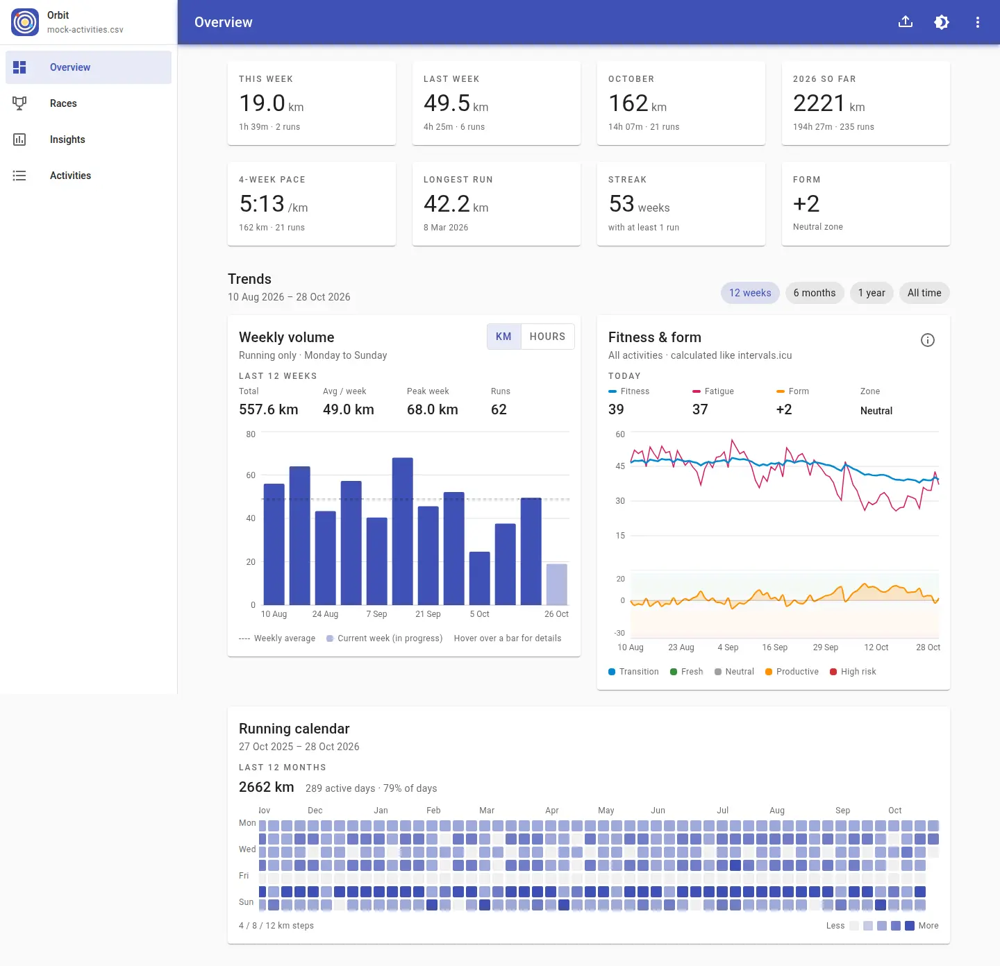

<p align="center">
  
</p>

# Orbit

Orbit is a local-first dashboard for your running history. Export your activities from
[intervals.icu](https://intervals.icu), load the CSV, and Orbit turns all those numbers into an
easy-to-read picture of your training: weekly volume, fitness and form, race predictions, personal
bests, and trends. There is no account and nothing is uploaded — your data stays in your browser.

## Screenshots

<p align="center">
  
</p>

## Running it

```bash
npm install
npm run dev       # http://localhost:5173
npm run build     # production build in dist/
npm run preview   # serve the production build, including the service worker
```

Open the app and choose the activities CSV exported from intervals.icu. Your imported activities and
race tags are saved in the browser's localStorage.

- **Upload new CSV** is the upload icon in the top app bar.
- **Data details** and **Clear data** are in the ⋮ menu.

## Testing

```bash
npm test          # unit tests
npm run test:e2e  # browser tests (Playwright, uses the installed Chrome)
```

The tests read `i463508_activities.csv` from the project root. That personal export is gitignored, so
place your own intervals.icu export there before running them. The browser suite also checks the web
app manifest and an offline reload.


## License

Orbit is free software licensed under the **GNU General Public License v3.0** — see
[LICENSE](LICENSE).

Copyright (C) 2026 Samuele Bella.

You may redistribute and/or modify Orbit under the terms of GPL-3.0. If you distribute a modified
version, you must make the corresponding source available under the same license. There is no
warranty.
